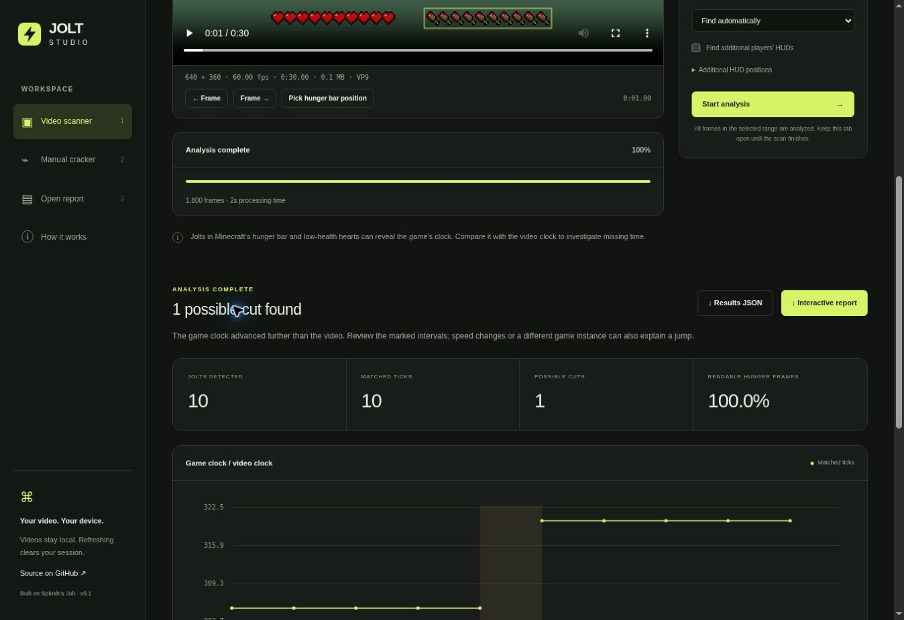

# Jolt Studio regression check — October 30, 2026

Application: https://dawsoncodes.github.io/Jolt-Studio/

Source reviewed: `228d710050d23ad087190fef45b9bd32eaf730b5`.
The most recent build/deploy workflow, run `40019501204`, is successful.
This audit changes documentation only; no UI or scanner source was edited.

## Passed

- GitHub repository access is restored and the repository is active.
- All nine checked hosted assets return HTTP 200 with appropriate content types.
- The rebuilt HTML, CSS, app, scanner worker, demo video and example report
  match the currently deployed files byte-for-byte.
- Every pinned upstream Jolt source hash matches its provenance manifest.
- Fresh `npm test`: 16 original manual-code checks, 15 original frame-timing
  checks, both native pixel-video fixtures, adapter validation and all six
  JavaScript/WebAssembly tests pass.
- The published WebAssembly binary exactly matches native detector JSON on
  continuous footage and the synthetic known-cut fixture.
- Fresh `npm run build` succeeds.
- Live automatic HUD detection and scanning read all 1,800 frames, match all
  10 jolts, and identify the known +15.25-second clock jump.
- Cancellation terminates a scan and leaves the selected video available.
- An end time before the start produces a validation error; correcting the
  range allows another complete successful scan.
- Live manual heart cracking returns the expected tick 25926.
- Clear removes the current video/results. Refresh returns to an empty session.
- Actual JSON and HTML exports download successfully. The JSON parses and has
  1,800 frames, 10 matched jolts, the expected +15.25s event and two JPEG witness
  images. The HTML contains the interactive viewer, result data and images.
- Re-importing the downloaded JSON restores the ticks, timeline and event.
- Source inspection finds no video upload endpoint or persistent browser file
  storage. The app's explicit fetches retrieve its bundled sample assets.

The previously documented inability to verify report downloads and file-chooser
import is resolved by this audit.

## Scope and remaining coverage

These are regression and synthetic-fixture checks, not an exhaustive accuracy
certification. Long real recordings, all browser/codec combinations, variable
footage quality and multiple simultaneous HUDs still need broader testing.
Browser decoding can produce pixels different from native FFmpeg.
YouTube URL import is not implemented.

The browser automation connection briefly disconnected during a scan, then
reconnected to the completed successful result. This did not stop the scanner.

