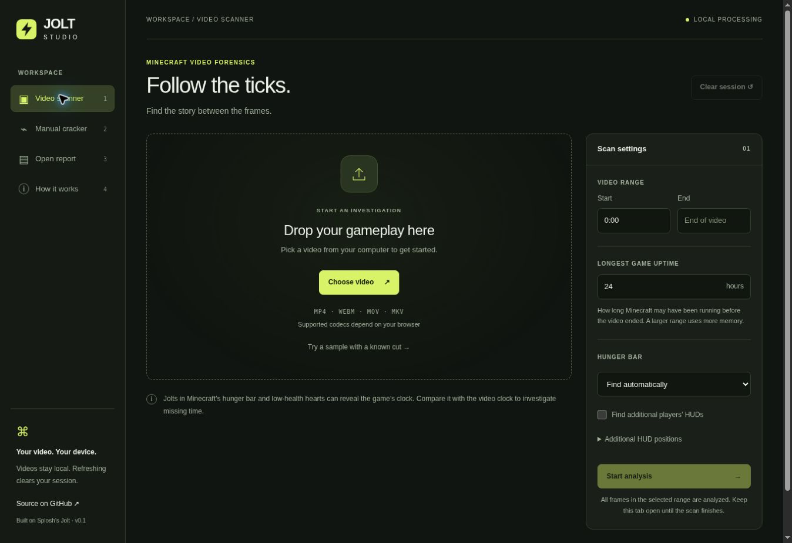
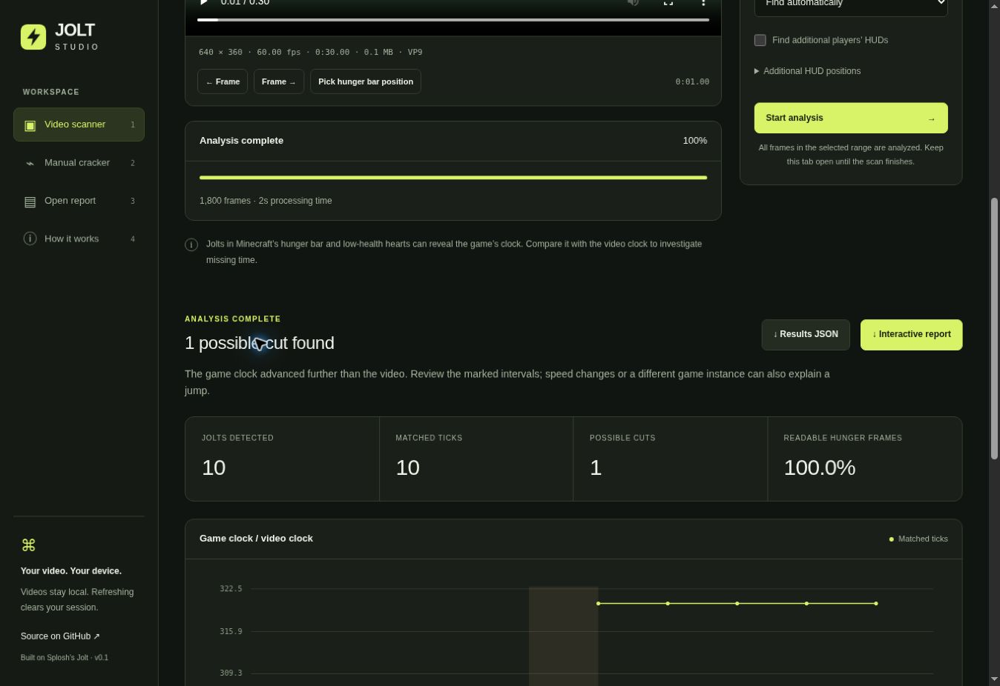

# UI cleanup verification — October 30, 2026

Code commit: `ce6a278d244b65d2ffa6dbe4eded75570af74287`.

[Successful build and Pages deployment](https://github.com/DawsonCodes/Jolt-Studio/actions/runs/41112424867).

## Changes

- Preserved the dark green/lime design while increasing text sizes, spacing, contrast, and control sizes.
- Made all four navigation options available on mobile, with a two-column navigation layout on the narrowest screens.
- Used keyboard-visible focus outlines so mouse selections do not leave misleading focus highlights. Added current-page and keyboard-shortcut accessibility labels.
- Made HUD picking cancel on an outside click, Escape, a tab change, or the start of an operation. Fit the HUD overlay to the video content, including letterboxing and resizing.
- Made Clear session reset video, results, scan settings, manual codes/output, filters, and picker state. Manual-only work now enables Clear session.
- Validated scan ranges before starting work, rejected out-of-video endpoints, reset progress at the start, and showed a stopped/error state on failures.
- Disabled sample/example actions during other operations and limited the manual cancel control to manual matching.
- Kept the previous working video/results when a replacement cannot be opened. Cleared cached worker metadata after a failed open so the previous file can actually be reopened and scanned.
- Cleared old scan results/settings on successful video replacement. An imported report can still retain its results when its source video is first attached.
- Added JSON-drop handling, readable malformed-report errors, saved-report labeling, and an empty-filter message.
- Fixed timestamp rounding at minute boundaries and calculated chart bounds over all readings rather than only the first 100,000.

## Verification

`npm test` passed locally: original manual/frame checks, native continuous/cut fixtures, browser-adapter checks, and all 10 JavaScript/WebAssembly tests. These include new regression tests for scan ranges, timestamp rollover, letterboxed overlay geometry, and malformed report rows. The GitHub build repeated the suite successfully and deployed the static app.

Desktop and phone layouts were inspected in the browser. At 390px and 320px test-frame widths, the page stayed within the viewport. Report and Help were visible and functional. Selecting a HUD mode and clicking the page heading left no focused control/highlight.

Manual matching in the preview recovered known tick **6222**. Invalid manual input produced an error, and Clear session removed the codes, output, and modified uptime.

The published HTTPS app passed these checks:

1. Automatic scan of the bundled 640×360, 60fps, 30-second synthetic fixture decoded **1,800 frames**, found **10 matched jolts**, and recovered the known **+15.25-second** clock jump.
2. An invalid range was rejected before progress appeared. An invalid HUD scale produced **Analysis stopped** and its actual error, rather than stale progress.
3. Cancelling retained the video; retrying recovered the same expected results.
4. HUD picking ended after clicking outside the preview.
5. Opening a non-video replacement produced a readable error while retaining the video/results and usable controls. Rescanning the retained video succeeded.
6. Replacing it with another valid video cleared the prior results/progress and restored automatic HUD mode and default uptime.
7. Actual JSON and HTML downloads succeeded. Downloaded bytes were checked for 1,800 frames, 10 matched jolts, the 15.25-second event, and both JPEG witness frames.
8. Clearing and refreshing returned the scanner to an empty session, with Scan/Clear disabled and default controls restored.

The local HTTP preview cannot use WebCodecs or reliably download HTML files because of browser security restrictions. Those checks were completed on the published HTTPS site instead. Browser file-chooser automation was slow; that delay is not a video-processing benchmark.

## Scope and limits

No dependencies, detector algorithms, GitHub Actions workflow, backend, Cloudflare resources, or Dawson Bot files were changed. Video analysis remains local. YouTube URL import remains deferred.

This verifies the synthetic fixture and the interactions above, not every codec/browser or hour-long gameplay recording. Full-length gameplay performance remains unbenchmarked.

