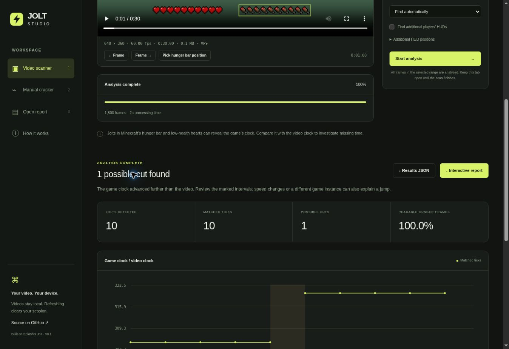
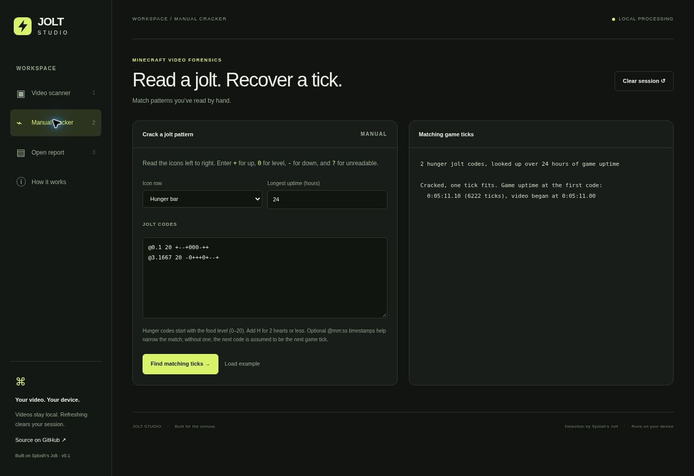

# Verification — 2026-10-23

Published application: https://dawsoncodes.github.io/Jolt-Studio/

GitHub Actions run `40019501204` at source commit
`9decfa85556a9d58707de632ca25f863614828cf` completed both build and deployment
successfully. Emscripten compilation, native tests, WebAssembly parity tests,
static bundling and Pages upload all passed.

## Observed in the deployed HTTPS application

- The synthetic 640×360 VP9 clip loaded with the correct 30s duration and 60 fps.
- A complete video scan with manual HUD coordinates decoded all 1,800 frames,
  matched 10 hunger jolts to game ticks, and reported one +15.25s clock jump.
- Repeating the scan with automatic hunger-bar finding produced the same 10
  matched jolts and +15.25s event. Processing was displayed as about 2s on the
  test browser; this is a small synthetic clip, not a performance guarantee.
- The timeline, event interval and jolt inspector displayed those results.
- Manual cracking of the documented two-code hunger example returned tick 6222.
- The saved example report rendered and the unmatched filter correctly showed
  zero entries. Refreshing discarded the temporary report and selected file.

## Verification limits

Real gameplay accuracy, all codecs, multiple simultaneous HUDs and very large
videos have not been comprehensively exercised. The detector's native and
WebAssembly outputs are identical on both pixel fixtures, not on an exhaustive
real-world corpus. Browser pixel conversion can differ from native FFmpeg.

The browser automation environment did not complete file-chooser attachment or
capture the HTML download successfully. The live video test used the bundled
clip as a browser File. The HTML renderer and generated content are separately
covered by the native/WebAssembly tests; final cloud-downloaded bytes were not
inspected. These limitations do not establish that a normal user's download
fails, but the download flow remains a manual verification item.
